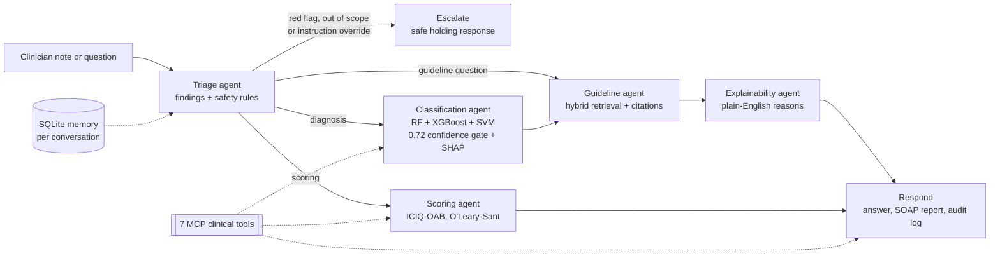

# UroAgent

[](https://colab.research.google.com/github/Muthuuk/UroAgent/blob/main/notebooks/UroAgent_Colab.ipynb)
[](https://huggingface.co/spaces/muthuuk/uroagent)


**A multi-agent decision-support tool for three common bladder conditions: overactive bladder (OAB), bladder pain syndrome (BPS) and urinary tract infection (UTI).**

UroAgent is the working implementation of the case study *AI Agent for Urological Prediction Models: A Full Modern Software Engineering Approach* (Ramachandran, 2026, ref. CS-URO-AI-2025-001). It triages a clinician's note, checks safety rules, suggests the most likely pattern with reasons, retrieves and cites guidance, estimates symptom scores, remembers the conversation, and logs every step.

> **Research demonstrator only. Synthetic data. Not a medical device.** Every output is advisory and must be reviewed by a clinician. It must not be used to make decisions about real patients.

---

## Run it in three ways

| Where | How | Needs |
|---|---|---|
| **Google Colab** | Click the Colab badge above, then **Runtime → Run all** (about one minute). The last cell opens the web app with a shareable link. | A Google account |
| **Hugging Face Space** | Open the Space badge for a permanent web link. To set it up, see [Deploy to Hugging Face](#deploy-to-hugging-face). | A Hugging Face account |
| **Your computer** | `pip install -r requirements.txt`, then `python app.py` (web app) or `python -m uroagent.cli demo` (text demo) | Python 3.10 or later |

No API key is needed. An optional step can reword the final answer with Claude if `ANTHROPIC_API_KEY` is set (`uroagent.agent.explain_with_llm`), but the language model can never change predictions, scores or safety decisions.

## How it works



The workflow runs as a **LangGraph StateGraph** (with a built-in fallback runner, so it works even without LangGraph). Each box is one function in `uroagent/agent.py`.

1. **Triage.** Reads the note, extracts 20 findings (frequency, nocturia, urgency, leakage, burning, pain and how it changes with bladder filling, dipstick results, duration and others) and decides what kind of request it is: diagnosis, scoring, guideline or out of scope. Follow-up questions such as *"What should I do first?"* are linked to the earlier assessment in the same conversation.
2. **Safety rules first.** Plain, readable rules in `uroagent/safety.py` run before any model. Visible haematuria, signs of sepsis or upper urinary infection, urinary retention and possible cauda equina are escalated with advice, and no diagnostic suggestion is given. Questions outside urology and attempts to override the agent's instructions are declined and logged.
3. **Classification.** A soft-voting ensemble of Random Forest, XGBoost and SVM, with the settings from the case study. If the top probability is below **0.72**, the answer is *Indeterminate* with a recommendation for specialist review. SHAP explains which findings pushed the result up or down.
4. **Guideline retrieval.** Six stages: entity-aware query, multi-query expansion, hybrid keyword (BM25) and vector (TF-IDF) search fused by Reciprocal Rank Fusion, de-duplication, re-ranking by condition and question intent, and compression to the most relevant sentence. Every answer cites its sources.
5. **Scoring.** ICIQ-OAB (0–16) and O'Leary-Sant (symptom index 0–20, problem index 0–16) calculators, plus clearly labelled estimates from free text.
6. **Explain and respond.** A plain-English answer with reasons and cited guidance, a SOAP report, and a mandatory clinician sign-off line. Every turn is written to an audit log that stores a hash of the input, never the note itself.

## The seven clinical tools (Model Context Protocol)

| Tool | What it does |
|---|---|
| `fhir_patient_query` | Returns a FHIR R4-style record for a synthetic patient (`demo-001`, `demo-002`, `demo-003`) |
| `iciq_score_calculator` | ICIQ-OAB total from four item scores |
| `bpss_score_calculator` | Bladder pain severity using the O'Leary-Sant structure |
| `lab_result_parser` | Reads nitrite, leukocytes, blood, culture and creatinine from a text report |
| `drug_interaction_checker` | Anticholinergic burden, mirabegron and blood pressure, nitrofurantoin and kidney function (illustrative rules) |
| `audit_logger` | Appends a tamper-evident audit entry (timestamp, input hash, outcome) |
| `guideline_version_checker` | Shows which guideline versions are in the knowledge base |

Run them as a real MCP server for MCP clients such as Claude Desktop:

```bash
python -m uroagent.mcp_server
```

## Results on synthetic data

Checked against the acceptance targets in the case study (`python -m uroagent.cli evaluate`):

| Check (case study reference) | Target | Result | |
|---|---|---|---|
| Classification accuracy (OG-01, NFR-03) | ≥ 0.87 | 0.893 | ✅ |
| AUROC, one-vs-rest | ≥ 0.91 | 0.945 | ✅ |
| Lowest per-class F1 | ≥ 0.85 | 0.884 | ✅ |
| Triage accuracy, 20 labelled queries | ≥ 0.90 | 1.000 | ✅ |
| Out-of-scope and injection escalation (OG-07) | 100% | 100% | ✅ |
| Retrieval precision@5 (OG-03) | ≥ 0.85 | 0.819 | ❌ known gap |
| Retrieval recall@5 | ≥ 0.80 | 0.819 | ✅ |
| Latency P95 (OG-05, NFR-01) | ≤ 8 s | 0.04 s | ✅ |
| Answers with guideline citations (NFR-10) | 100% | 100% | ✅ |
| Follow-up answered in context (OG-06) | uses memory | yes | ✅ |

**Known gaps, reported honestly.** Retrieval precision is just below target because the demonstrator uses lightweight keyword and TF-IDF search over 25 short cards, so it runs on free hardware. Neural embeddings and a cross-encoder re-ranker, as in the case study, are the planned upgrade. The fairness check shows recall gaps by sex of up to 0.11, above the case study's 0.05 target. With synthetic data this mainly reflects the small number of men in the sample, but it shows why the subgroup check must be repeated on real data.

These results come from synthetic data. They show that the pipeline and its safety controls work, not how the tool would perform with real patients.

## Data and knowledge

- **Training data:** 1,500 synthetic clinical notes (`uroagent/data.py`). Symptom patterns overlap on purpose, and 8% of cases present with another condition's pattern, so the task is realistic rather than trivial. No real patient data are used.
- **Guideline knowledge:** 25 short **paraphrased summaries** (`knowledge/guideline_cards.json`) referencing NICE NG123, NG109, NG112, NG12 and TA290, UKHSA's UTI diagnostic guide, the MHRA drug safety update on mirabegron, the AUA IC/BPS guideline (2022 amendment) and the EAU chronic pelvic pain guidelines. They are not guideline text and may be out of date. Replace them with licensed, current content and check every statement before any real use.
- **Questionnaires:** the ICIQ-OAB and O'Leary-Sant questionnaires are licensed, so only their scoring structure is used here.

## Repository layout

```
uroagent/
  agent.py        LangGraph workflow: triage, classify, retrieve, score, explain, respond, escalate
  safety.py       red flags, out-of-scope and prompt-injection rules
  ner.py          clinical finding extraction from free text
  classifier.py   RF + XGBoost + SVM ensemble, confidence gate, SHAP
  rag.py          hybrid BM25 + TF-IDF retrieval, rank fusion, re-ranking, compression
  scoring.py      ICIQ-OAB and O'Leary-Sant scoring
  tools.py        seven MCP-style clinical tools (synthetic data)
  mcp_server.py   the tools as a real MCP server
  memory.py       SQLite conversation memory per thread
  evaluate.py     acceptance targets and fairness check
  webapp.py       Gradio web app (Colab and Hugging Face)
  cli.py          command line: demo, ask, evaluate, tools
knowledge/        guideline knowledge cards (paraphrased)
notebooks/        UroAgent_Colab.ipynb
space/            Hugging Face Space README and requirements
tests/            15 tests: safety, routing, models, retrieval, memory, tools, MCP
app.py            web app entry point
```

## Command line

```bash
python -m uroagent.cli demo                       # worked conversation, safety cases
python -m uroagent.cli ask "45-year-old woman, burning, cloudy urine, nitrites positive, 2 days" --trace
python -m uroagent.cli evaluate                   # targets and fairness
python -m uroagent.cli tools                      # list the clinical tools
python -m pytest -q                               # run the tests
```

## Deploy to Hugging Face

**Automatic (recommended).** This repository includes a GitHub Action that copies the app to your Space on every push to `main`:

1. Create a Hugging Face access token with *write* permission (Hugging Face → Settings → Access Tokens).
2. In this GitHub repository, open **Settings → Secrets and variables → Actions**. Add a secret `HF_TOKEN` (the token) and a variable `HF_SPACE` (for example `muthuuk/uroagent`).
3. Push any change, or run the workflow by hand from the **Actions** tab. The Space is created if it does not exist.

**Manual.** Create a new Gradio Space and upload `app.py`, `LICENSE`, the `uroagent/` and `knowledge/` folders, and the two files in `space/` (as `README.md` and `requirements.txt`).

## Governance

Designed with the V-EGRCSbyD (Validation, Ethics, Governance, Risk, Compliance and Security by Design) approach from the case study:

- human-in-the-loop on every answer;
- a confidence gate;
- safety rules outside the models;
- an audit trail without raw notes;
- no patient identifiers in prompts;
- a fairness check by sex and age group;
- an explicit scope with escalation.

Any clinical use would need a clinical safety case (DCB0129 and DCB0160), MHRA conformity assessment as software as a medical device, a DPIA, and validation on real, approved data.

## Citation

```bibtex
@misc{ramachandran2026uroagent,
  author = {Ramachandran, Muthu},
  title  = {UroAgent: a multi-agent decision-support demonstrator for urology},
  year   = {2026},
  note   = {Implementation of case study CS-URO-AI-2025-001. https://github.com/Muthuuk/UroAgent}
}
```

Design based on Infante, R. (2025) *AI Agents and Applications: With LangChain, LangGraph, and MCP*. Manning.

Code: MIT licence. Maintainer: Prof Muthu Ramachandran, Forti5 Technologies Ltd and CAIDS, University of South Africa ([ORCID 0000-0002-5303-3100](https://orcid.org/0000-0002-5303-3100)).
